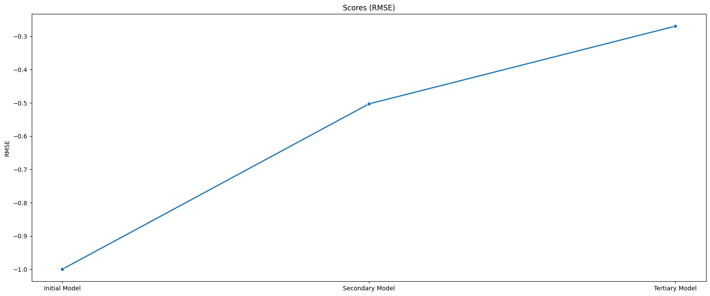

# Bike Sharing Demand Prediction with AutoGluon

Forecasts hourly bike-rental demand for the [Kaggle Bike Sharing Demand](https://www.kaggle.com/c/bike-sharing-demand) competition using **AutoGluon** tabular AutoML, improving the Kaggle score from **1.864 to 0.421** through feature engineering and tuning.

## Results
| Stage | AutoGluon val. RMSE (log target) | Kaggle score | Changes |
|---|---|---|---|
| Initial | -1.000 | 1.86413 | Defaults |
| Secondary | -0.503 | **0.42063** | Feature engineering and cleaning |
| Tertiary | -0.269 | 0.42091 | Hyper-parameter tuning and extra features |

| Validation RMSE by stage | Kaggle score by stage |
|---|---|
|  |  |

The best model was a **weighted ensemble** (CatBoost, LightGBM, XGBoost and neural nets) trained with the `best_quality` preset.

## What made the difference
- **Log-transforming the target:** rental counts are heavily right-skewed.
- **Datetime features:** hour, day, month, weekday and year, plus `weekday_bool` and `rushhour_bool` flags (demand peaks at rush hour).
- **Polynomial features** and per-model hyper-parameter search (GBM, XGBoost, Random Forest, NN).
- Dropping the `casual` / `registered` columns, which are absent from the test set.


## Next steps
Holiday and lag features (the data is a time series), Bayesian hyper-parameter optimisation, and deeper neural models.

## Repository contents
| Path | Description |
|------|-------------|
| `sharingdemand.ipynb` | Training notebook: EDA, features, AutoGluon runs |
| `preoject_report.ipynb` / `project_report.pdf` / `project_report.html` | Written project report |
| `data/` | Kaggle train and test CSVs |
| `graphs/` | EDA and score charts |
| `submissions/` | Kaggle submission files (the main ones are `initial_submission.csv`, `secondary_submission.csv` and `tertiary_submission.csv`) |

## Run it
```bash
pip install autogluon pandas matplotlib seaborn jupyter
jupyter notebook sharingdemand.ipynb
```
Submitting to Kaggle needs a Kaggle API token (`~/.kaggle/kaggle.json`).

## Tech stack
Python 3.10 · AutoGluon 1.2 · pandas · Matplotlib · Seaborn · Kaggle API
